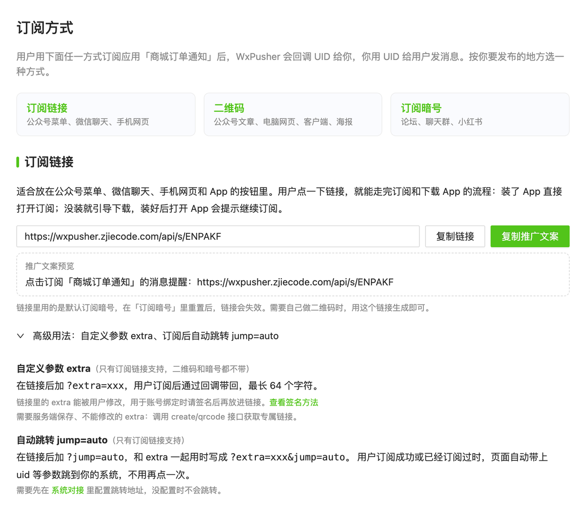
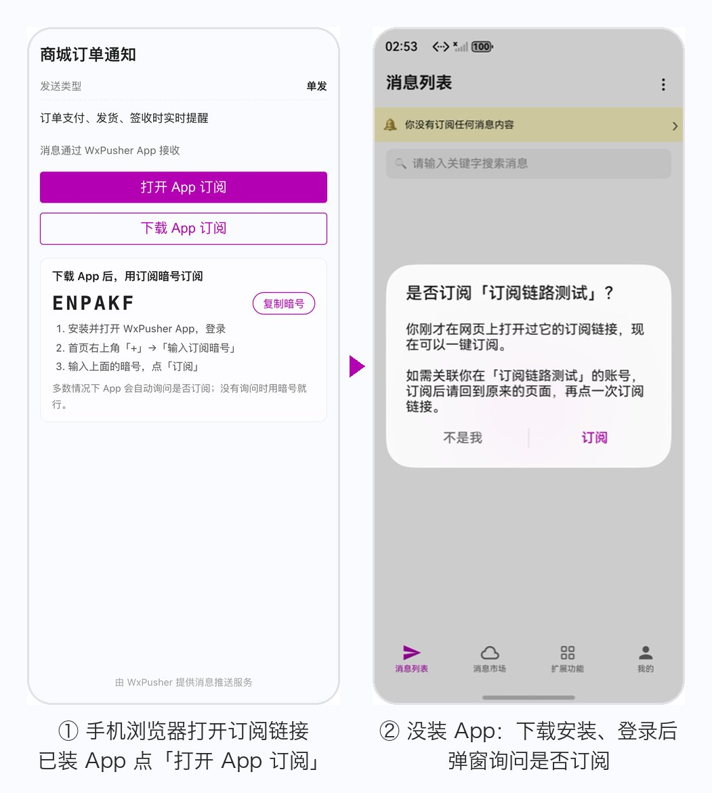
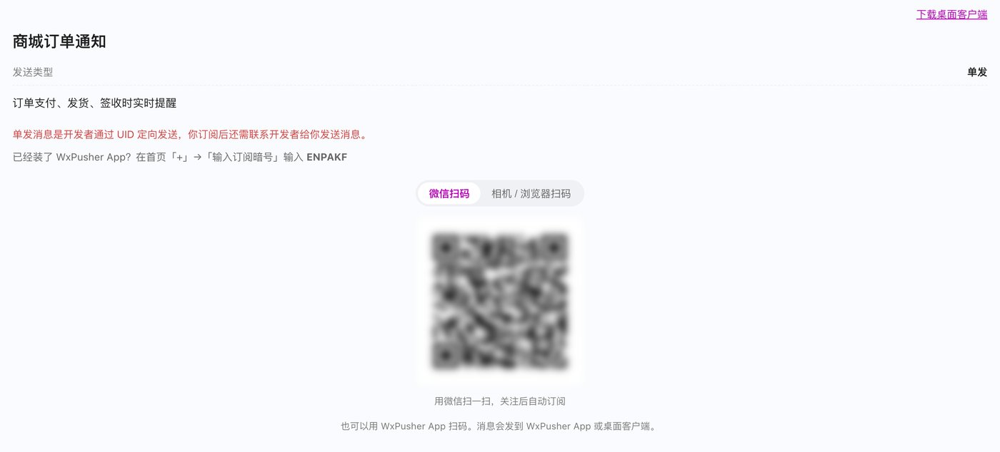
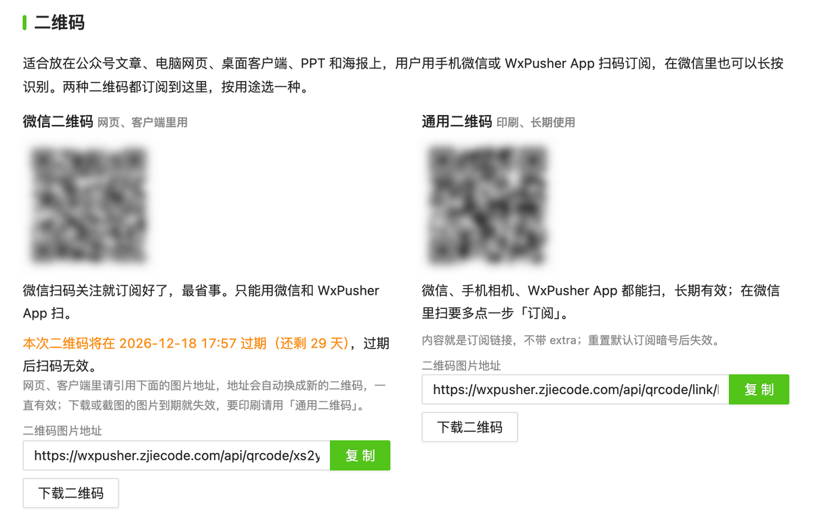
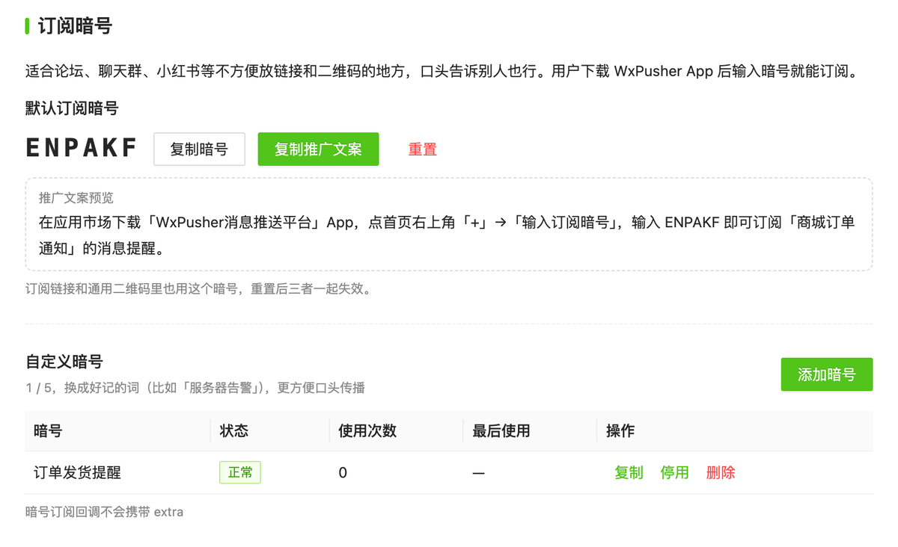
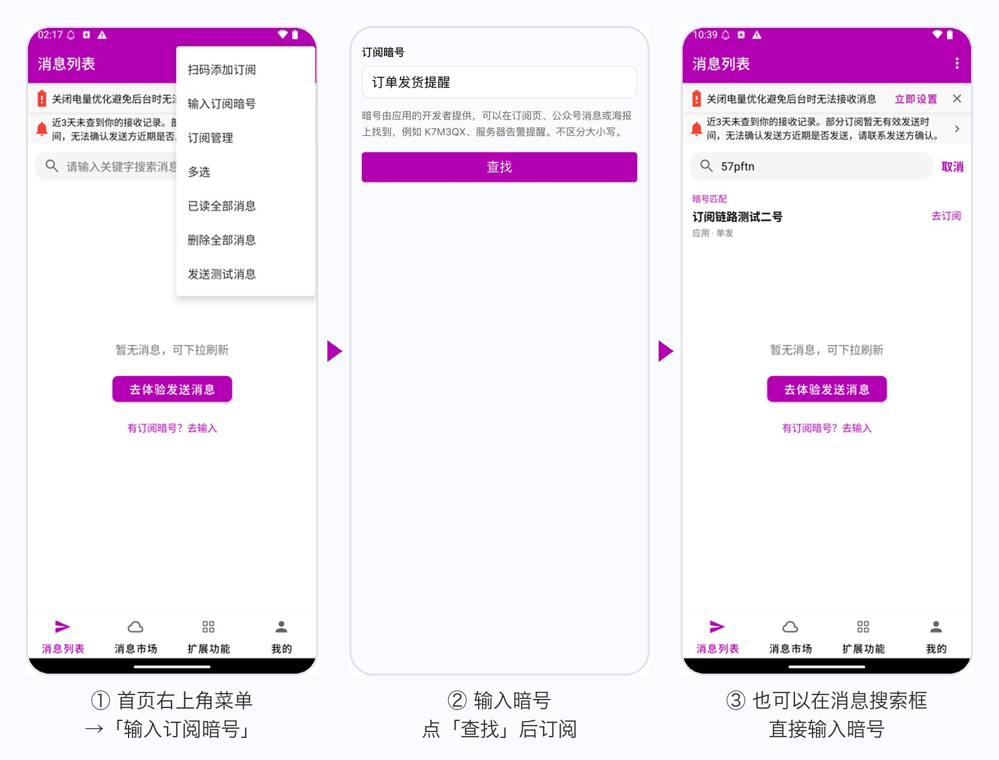

<a href="#/">← 返回 WxPusher 文档首页</a>

# WxPusher 订阅方式：订阅链接、二维码、订阅暗号怎么选

> 由 WxPusher 维护 · 最后更新：2026-11-18

用户订阅了你的应用或主题，你才能给他发消息。以前，用户基本只能在微信里扫码、关注公众号来订阅。现在公众号已经不能推送消息，用户最终要在 WxPusher App（或桌面客户端）里收消息，所以 WxPusher 把订阅流程整体升级了：

- **一个订阅链接走遍所有环境**：微信、手机浏览器、WxPusher App、电脑都能打开，用户不需要先装 App；
- **两种二维码**：微信二维码在微信里最省事，通用二维码手机相机也能扫，适合印刷；
- **订阅暗号**：一串好记的字，适合论坛、聊天群、小红书这类不方便放链接的地方，口头告诉别人也行；
- **订阅后自动引导下载 App**，没装 App 的用户装好后，App 会询问是否继续订阅，订阅意图尽量不丢。

本文按「你要发布在哪里」介绍每种方式，以及用户在每种场景下实际看到的流程。

## 三种订阅方式，按发布的地方选

| 订阅方式 | 适合发布在 | 用户要做什么 | 能带 extra | 回调里的 `source` |
|---|---|---|---|---|
| **订阅链接** | 公众号菜单、微信聊天、手机网页、你自己 App 里的按钮 | 点一下链接 | 能 | `link` |
| **二维码** | 公众号文章、电脑网页、桌面客户端、PPT、海报 | 用微信或手机扫码 | 默认不带；需要时用带 extra 的链接自己生成 | `scan` |
| **订阅暗号** | 论坛、聊天群、小红书、口头传播 | 在 App 里输入暗号 | 不能 | `code` |

三种方式都订阅到同一个应用或主题，可以同时使用。不知道选哪个时，优先用**订阅链接**：它在各种环境下都能走通。

## 在哪里获取

登录 [WxPusher 管理后台](https://wxpusher.zjiecode.com/admin/)：

- 应用：左侧菜单「应用管理 → 关注订阅」；
- 主题：「主题管理」列表里点主题的「关注订阅」。

应用和主题的订阅方式、用户看到的流程都一样，只是查看的入口不同；另外主题订阅没有回调，也不支持 extra。

页面顶部按投放场景分成「订阅链接」「二维码」「订阅暗号」三段，点击可以直接跳到对应的分段。订阅链接和订阅暗号都提供「复制推广文案」，复制后可以直接发到群里或贴到页面上。



## 方式一：订阅链接

链接形如 `https://wxpusher.zjiecode.com/api/s/K7M3QX`，最后一段是这个应用或主题的**默认订阅暗号**。推广文案是：

```text
点击订阅「商城订单通知」的消息提醒：https://wxpusher.zjiecode.com/api/s/K7M3QX
```

同一个链接，在不同环境里打开，用户看到的流程不一样，但都能走到「订阅成功 + 用 App 收消息」：

| 用户在哪里打开 | 用户看到的流程 |
|---|---|
| WxPusher App 里 | 进入订阅页，点「订阅」即可；没登录会先登录，登录后回到订阅页 |
| 微信里，已关注公众号 | 落地页点「订阅」→ 订阅成功页 |
| 微信里，未关注公众号 | 落地页显示公众号二维码 → 长按识别、关注即订阅 → 订阅成功页 |
| 手机浏览器，已装 App | 系统直接拉起 App 进入订阅页；已经停在浏览器里时，点「打开 App 订阅」 |
| 手机浏览器，没装 App | 落地页点「下载 App 订阅」→ 安装、登录 → App 弹窗询问是否订阅 |
| 电脑浏览器 | 显示二维码和订阅暗号，用手机扫码或在 App 里输入暗号 |

### 微信里：订阅成功后引导装 App

用户在微信里订阅成功后，会看到下面的页面。公众号已经不能推送消息，所以页面会明确告诉用户「还差一步」：

- **打开 WxPusher App**：已安装时直接拉起 App（部分环境不支持直接拉起时，会转到下载页）；
- **还没有 App？立即下载**：跳转到下载页；
- 安装后用**微信登录**，在微信里完成的订阅会自动同步；没用微信登录的，用页面下方的订阅暗号再订阅一次即可。

扫码关注后，公众号也会回复一条消息和一张「下载 WxPusher App 接收消息」的卡片，点开同样是这个页面。


### 手机浏览器：已装直接打开，没装引导下载

在手机浏览器、QQ 等非微信环境打开链接时：

- **已安装 App**：系统会直接拉起 App 进入订阅页；如果页面已经在浏览器里打开，点「打开 App 订阅」即可；
- **没有安装**：点「下载 App 订阅」去下载。下载安装、同意隐私政策并登录后，App 会弹窗询问「是否订阅「XXX」？」，点「订阅」就完成了。万一没有弹窗，用页面上显示的订阅暗号在 App 里输入即可。



### 电脑上打开

电脑上打开链接时，页面显示二维码和订阅暗号，用户拿出手机扫码，或在 App 里输入暗号。二维码可以在「微信扫码」和「相机 / 浏览器扫码」之间切换。右上角提供桌面客户端下载入口。



### 链接的高级用法

只有订阅链接支持下面两个参数（应用支持，主题不支持 extra）：

- **`extra` 自定义参数**：`https://wxpusher.zjiecode.com/api/s/K7M3QX?extra=xxx`，最长 64 个字符，用户订阅后通过[用户关注回调](/?id=subscribe-callback)原样带回。用途、两种写法和加签验证见下一节。
- **`jump=auto` 自动跳转**：`?jump=auto`，和 extra 一起用时写成 `?extra=xxx&jump=auto`。用户订阅成功或已经订阅过时，页面自动带上 uid 等参数跳到你的系统，需要先在「应用管理 → 系统对接」配置跳转地址，详见[系统对接](/?id=setting-url-sign)。

### extra 能做什么，怎么防伪造 :id=extra-sign

extra 是你放在订阅链接上的一段自定义字符串（仅应用支持），用户订阅后会通过[用户关注回调](/?id=subscribe-callback)原样带回，让你知道「这个 UID 从哪来、对应你系统里的谁」。常见用法：

| 用途 | extra 放什么 | 收到回调后做什么 |
|---|---|---|
| 账号绑定 | 你系统里的用户标识，例如 `10086` | 把回调里的 UID 存到这个用户名下，以后按用户发消息 |
| 业务对象订阅 | 订单号、服务器 ID、监控项 ID 等 | 把 UID 和这个对象关联，对象有变化时只通知订阅了它的人 |
| 渠道统计 | 渠道代号，例如 `ch_xhs`、`ch_poster` | 按 extra 统计各渠道带来了多少订阅 |
| 邀请奖励 | 邀请人编号 | 给邀请人记一次有效邀请 |

有两种方式生成带 extra 的链接，用户看到的流程一样：

| 方式 | 写法 | 链接里的 extra 能否被用户修改 |
|---|---|---|
| A. 链接直接拼 | `https://wxpusher.zjiecode.com/api/s/{默认订阅暗号}?extra=xxx`，不用调接口 | 能 |
| B. 接口创建 | 调用[创建参数二维码](/?id=create-qrcode)，返回值里的 `link` 就是带 extra 的订阅链接，extra 存在服务端 | 不能 |

- extra 最长 64 个字符；方式 B 的链接上再拼 extra 不生效；方式 B 的链接和二维码有效期相同，过期后需要重新创建。
- 用户没装 App 时，只有安装后高置信还原才带回 extra（见下文「没装 App 的用户，装好后怎么接上」）。安全要求高的业务，可以在给这个 UID 发敏感消息前，让用户在你的系统里再确认一次绑定。

**用于账号绑定、邀请奖励时，请加签验证**

WxPusher 只负责把 extra 原样带回，不判断它是否可信。方式 A 的 extra 写在链接上，任何人都能改：如果 extra 是明文的 `10086`，别人把它改成 `10087` 再订阅，你就会把他的 UID 绑到 10087 这个用户上，之后 10087 的消息都会发给他。所以 extra 只用于渠道统计时可以明文；用于账号绑定、邀请奖励等会产生权益的场景，请在你的服务端加签，收到回调时验签。

推荐格式：`extra = {用户标识}.{过期时间}.{签名}`，例如 `10086.1795099042.VTsPiB2mvkUTZr2P`。

1. **生成链接**（在用户登录你的系统、点「开启消息通知」时生成，不要提前写死在页面里）：
   - `过期时间` 用秒级时间戳，建议 1 天以内；
   - `签名` = 用只有你服务端知道的密钥，对 `{用户标识}.{过期时间}` 做 HMAC-SHA256，结果用 base64url 编码后取前 16 个字符；
   - 用户标识只用字母、数字、`-`、`_`，最长 36 个字符，这样整个 extra 不超过 64 个字符，也可以直接拼在链接上，不用转义。
2. **收到回调**：按 `.` 拆成三段，用同一个密钥重新计算签名，和第三段一致、并且过期时间没到，才把 UID 绑定到这个用户。比较签名时用常量时间比较，避免时序攻击。
3. **不想自己签名**：用方式 B，extra 存在服务端，用户改不了；为了两种方式统一处理，也可以同样签名。

> 签名能防止别人伪造或篡改 extra，但防不住用户把自己的链接转给别人：别人用这个链接订阅，同样会绑定到原用户名下。所以链接要现生成、设置较短的过期时间，并且只展示给已经登录的本人。

各语言示例（`secret` 是你自己生成的随机密钥，只放在服务端，和 WxPusher 后台的任何密钥都无关）：

```js
// Node.js
const crypto = require('crypto');
const sign = (s) => crypto.createHmac('sha256', secret).update(s).digest('base64url').slice(0, 16);

// 生成链接
const exp = Math.floor(Date.now() / 1000) + 24 * 3600;
const extra = `${userId}.${exp}.${sign(`${userId}.${exp}`)}`;
const link = `https://wxpusher.zjiecode.com/api/s/K7M3QX?extra=${extra}`;

// 收到回调，验签通过返回用户标识，否则返回 null
function verifyExtra(extra) {
  const [id, exp, sig] = (extra || '').split('.');
  if (!id || !exp || !sig || Number(exp) < Date.now() / 1000) return null;
  const expect = Buffer.from(sign(`${id}.${exp}`));
  const actual = Buffer.from(sig);
  return expect.length === actual.length && crypto.timingSafeEqual(expect, actual) ? id : null;
}
```

```python
# Python
import base64, hashlib, hmac, time

def sign(s):
    mac = hmac.new(secret.encode(), s.encode(), hashlib.sha256).digest()
    return base64.urlsafe_b64encode(mac).decode().rstrip('=')[:16]

# 生成链接
exp = int(time.time()) + 24 * 3600
extra = f'{user_id}.{exp}.{sign(f"{user_id}.{exp}")}'

# 收到回调，验签通过返回用户标识，否则返回 None
def verify_extra(extra):
    parts = (extra or '').split('.')
    if len(parts) != 3 or not parts[1].isdigit() or int(parts[1]) < time.time():
        return None
    uid, exp, sig = parts
    return uid if hmac.compare_digest(sign(f'{uid}.{exp}'), sig) else None
```

```java
// Java
static String sign(String s, String secret) throws Exception {
    Mac mac = Mac.getInstance("HmacSHA256");
    mac.init(new SecretKeySpec(secret.getBytes(StandardCharsets.UTF_8), "HmacSHA256"));
    byte[] raw = mac.doFinal(s.getBytes(StandardCharsets.UTF_8));
    return Base64.getUrlEncoder().withoutPadding().encodeToString(raw).substring(0, 16);
}

// 生成链接
long exp = System.currentTimeMillis() / 1000 + 24 * 3600;
String extra = userId + "." + exp + "." + sign(userId + "." + exp, secret);

// 收到回调，验签通过返回用户标识，否则返回 null
static String verifyExtra(String extra, String secret) throws Exception {
    String[] p = extra == null ? new String[0] : extra.split("\\.");
    if (p.length != 3 || !p[1].matches("\\d+") || Long.parseLong(p[1]) < System.currentTimeMillis() / 1000) {
        return null;
    }
    byte[] expect = sign(p[0] + "." + p[1], secret).getBytes(StandardCharsets.UTF_8);
    return MessageDigest.isEqual(expect, p[2].getBytes(StandardCharsets.UTF_8)) ? p[0] : null;
}
```

## 方式二：二维码

后台提供两种二维码，都订阅到同一个应用或主题，并排展示，按用途选一种：

| 对比项 | 微信二维码 | 通用二维码 |
|---|---|---|
| 适合放在哪 | 网页、App、客户端里，引用图片地址 | 印刷海报、PPT、群公告图片等长期使用的地方 |
| 能用什么扫 | 微信、WxPusher App | 微信、手机相机、浏览器、WxPusher App 等任意扫码工具 |
| 微信扫，没关注公众号 | 弹出关注页，点「关注」就订阅好了 | 先打开落地页，再长按识别、关注，多 2 步 |
| 手机相机扫 | 识别不了 | 已装 App 直接拉起订阅；没装引导下载 |
| WxPusher App 扫 | 直接订阅，一步完成 | 直接订阅，一步完成 |
| 会不会过期 | 下载或截图的图片最长 30 天过期；**引用图片地址**时地址会自动换成新的二维码，一直有效 | 长期有效，只有重置默认订阅暗号后才失效 |



一句话：用户主要在微信里扫、页面能引用图片地址，用**微信二维码**；要印刷、长期使用，或者用户可能用手机相机扫，用**通用二维码**。

两种二维码都不带 extra。需要 extra 时，用带 extra 的订阅链接自己生成二维码即可，任何扫码工具都能识别。

用户扫码后看到的流程：

- **微信扫微信二维码**：没关注的弹出关注页，关注即订阅；已关注的直接订阅。随后公众号回复一条消息，引导下载 App（同上文「微信里：订阅成功后引导装 App」）。
- **扫通用二维码**：相当于打开订阅链接，流程见「方式一」。
- **WxPusher App 扫任意一种**：直接订阅，弹出「订阅成功」。老版本 App 扫通用二维码同样可以一步订阅。

## 方式三：订阅暗号

订阅暗号是给人看、给人输入的。每个应用和主题都有：

- **默认订阅暗号**：创建时自动生成，6 位大写字母和数字（不含容易混淆的 0、1、I、L、O），例如 `K7M3QX`。订阅链接和通用二维码里用的也是它，在后台重置后，旧暗号、旧链接、旧通用二维码一起失效。
- **自定义暗号**：你可以给应用或主题起几个好记的词，例如「订单发货提醒」。每个最多 5 个，2–16 个字符，只能是中文、字母、数字；全局唯一、先到先得，不区分大小写；不能包含 WxPusher、官方、客服等平台保留词，也不能只用「订阅」「测试」这类通用词；不能是 6 位纯字母数字（留给默认订阅暗号）。删除后不会释放给别人，防止已经印出去的海报被抢注。



推广文案是：

```text
在应用市场下载「WxPusher消息推送平台」App，点首页右上角「+」→「输入订阅暗号」，输入 K7M3QX 即可订阅「商城订单通知」的消息提醒。
```

用户在 App 里有三个地方可以输入暗号：首页右上角菜单里的「输入订阅暗号」、消息列表为空时的「有订阅暗号？去输入」、以及消息搜索框和消息市场搜索框（直接输入暗号就能搜到）。找到后进入订阅页，点「订阅」完成。



暗号订阅只指向应用或主题本身，**回调不带 extra**。为防止被枚举，「输入订阅暗号」页每台设备每小时最多查询 10 次，连续输错 5 次后需要等一段时间再试。

## 没装 App 的用户，装好后怎么接上

用户在手机浏览器打开订阅链接、但还没装 App 时，落地页会记录这次订阅意图。用户安装、同意隐私政策并登录后，App 会尝试找回这个意图：

| 匹配结果 | 用户看到 | 回调 |
|---|---|---|
| 高置信 | 弹窗「是否订阅「XXX」？」，点「订阅」后完成 | 带 extra，`extraFrom` 为 `install_restore`，`source` 为 `install_restore` |
| 中置信 | 同样弹窗确认；意图带 extra 时，弹窗会提示用户回到原页面再点一次链接 | 不带 extra，`source` 为 `install_restore` |
| 没匹配到 | 不弹窗，用户用落地页上的订阅暗号订阅 | 按暗号订阅回调，`source` 为 `code` |

弹窗都需要用户确认，可以点「不是我」拒绝。高置信还原的准确率很高但不是 100%，安全要求高的业务，可以在给这个 UID 发敏感消息前，让用户在你的系统里再确认一次绑定。

## 回调怎么区分来源

用户通过应用订阅后，WxPusher 会调用你配置的回调地址（主题订阅没有回调），格式见[用户关注回调](/?id=subscribe-callback)。和订阅方式相关的字段：

| 字段 | 取值 |
|---|---|
| `source` | `scan` 扫码关注，`link` 链接订阅，`code` 输入订阅暗号，`install_restore` 下载 App 后还原订阅，`command` 通过消息订阅；以后可能新增，请做好兼容 |
| `extra` | 链接或参数二维码带的自定义参数；没有时为空 |
| `extraFrom` | `api` 接口创建（用户改不了），`link` 链接上直接拼（可能被修改），`install_restore` 下载 App 后高置信还原；没有 extra 时为空 |

## 升级前的订阅方式还能用吗

能，升级是兼容的，已经发出去的链接和二维码不需要重新生成：

- **老订阅链接**（`/app/?type=1&id=xxx#/follow`、`/wxuser/#/follow` 这类）：在 WxPusher App 里打开和以前一样；在 App 外打开会自动跳转到新的订阅链接，`jump=auto` 继续有效。
- **已经分发的微信二维码**，包括[创建参数二维码](/?id=create-qrcode)接口生成的带 extra 的二维码：在有效期内继续可用，扫码关注即订阅，回调和以前一样。
- **创建参数二维码接口**：返回值新增 `link` 字段，就是带这个 extra 的订阅链接，原有字段不变。
- **回调**：只新增了 `extraFrom` 字段和 `source` 的新取值，原有字段含义不变。请确保回调处理代码能接受未知的 `source` 取值。
- **老版本 App**：扫通用二维码也能一步订阅；新的订阅暗号入口、安装后还原需要升级到新版本 App。

## 常见问题

**用户没装 App 能订阅吗？**
能。在微信里可以先关注公众号完成订阅，再下载 App 用微信登录，订阅会自动同步；在其他环境里，落地页会引导下载，装好后 App 会询问是否继续订阅，也可以用订阅暗号订阅。不过要收到消息，最终需要安装 WxPusher App 或桌面客户端。

**微信公众号还能收到消息吗？**
不能。公众号已经不能推送消息，消息只会发到 WxPusher App、桌面客户端，以及用户在 App 里绑定的微信 ClawBot 渠道。

**订阅链接、二维码、暗号可以同时用吗？**
可以。它们都指向同一个应用或主题，你可以在不同的地方放不同的方式。

**我重置了默认订阅暗号会怎样？**
旧暗号、用它组成的订阅链接和通用二维码都会立即失效，已经订阅的用户不受影响。已经印出去的物料请谨慎重置。

**主题能带 extra 吗？**
不能。主题订阅没有回调，extra 只对应用生效。

**extra 会被用户伪造吗？**
链接上直接拼的 extra 能被改。用于账号绑定、邀请奖励时，请用 HMAC 加签并在回调里验签，或者改用创建参数二维码接口返回的 `link`，见上面的[「extra 能做什么，怎么防伪造」](#extra-sign)。

**用户订阅后，我怎么拿到 UID？**
在应用里配置回调地址，用户订阅后 WxPusher 会把 UID 推送给你；没有服务端时也可以轮询[查询扫码用户UID](/?id=query-uid)接口，或在后台「用户管理」里查看。

## 相关文档

- [用户关注回调](/?id=subscribe-callback)
- [创建参数二维码](/?id=create-qrcode)
- [系统对接：跳转到你的系统](/?id=setting-url-sign)
- [下载 WxPusher 客户端](https://wxpusher.zjiecode.com/download/)
